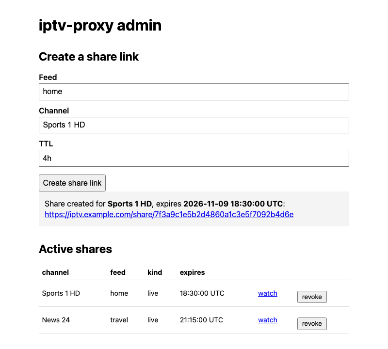

# iptv-proxy

Serves multiple upstream M3U8/Xtream IPTV feeds from one address, each behind its own username and password. Every playlist, segment and API response is rewritten so the real upstream URL and its credentials never reach the client.

## Features

- **Many feeds, one port.** The credentials on a request decide which feed serves it.
- **M3U and Xtream Codes.** The same feed works as a playlist URL or as an Xtream login, including `player_api.php`, `panel_api.php` and the EPG.
- **Smoother live playback.** Live streams reconnect when the upstream drops, and an optional delay buffer hides short stalls from the player.
- **Less upstream traffic.** Playlists and EPG data are cached, and the last good copy is served if a refresh fails.
- **Temporary share links.** Send one channel to someone for a limited time without giving out feed credentials.
- **Prometheus metrics** at `/metrics`, and a health check at `/health`.

## Install

### Docker

```sh
docker run -d --name iptv-proxy \
  --user "$(id -u):$(id -g)" \
  -p 58033:58033 \
  -v "$PWD/config.yaml:/config/config.yaml:ro" \
  ghcr.io/oskarrn93/iptv-proxy:latest
```

Images are published for `linux/amd64` and `linux/arm64`, tagged `X.Y.Z`, `X.Y`, `X` and `latest`. The registry is private, so run `docker login ghcr.io` first. `--user` should match the owner of `config.yaml`.

### Binary

Each [release](https://github.com/oskarrn93/iptv-proxy/releases) has archives for Linux and macOS on amd64 and arm64, plus `checksums.txt`.

```sh
gh release download --repo oskarrn93/iptv-proxy --pattern '*_linux_amd64.tar.gz'
tar -xzf iptv-proxy_*_linux_amd64.tar.gz
./iptv-proxy_*_linux_amd64/iptv-proxy -config config.yaml
```

## Configure

Copy [`config.yaml.example`](config.yaml.example) to `config.yaml` and fill in your feeds. The example documents every option.

```yaml
listen_addr: ":58033"

feeds:
  - name: feed-1
    upstream_url: "http://provider.example.com:8080/get.php?username=UPSTREAM_USER&password=UPSTREAM_PASS&type=m3u_plus&output=ts"
    username: proxyuser1
    password: proxypass1
```

Each feed's `username` must be unique across the file. Set the environment variable `METRICS_ENABLED=false` to turn off metrics.

## Connect a player

| App expects | Use |
| --- | --- |
| M3U URL | `http://<host>:58033/playlist.m3u8?username=<username>&password=<password>` |
| Xtream login | Server `http://<host>:58033`, with `<username>` and `<password>` |
| EPG (XMLTV) URL | `http://<host>:58033/epg?username=<username>&password=<password>` |

HTTP Basic Auth also works in place of the query parameters.

## Admin page



`/admin` creates and revokes share links. The app has no login of its own, so put it behind an authenticating reverse proxy.

As a backstop, `/admin/*` only answers requests that arrive through a `trusted_proxies` peer from a client inside `admin_allowed_cidrs`. If either list is empty, the admin page is disabled.

## Development

Requires Go 1.27.

```sh
go run ./cmd/iptv-proxy -config config.yaml
go test ./...
```

The admin UI has its own browser tests; see [`admin_ui_test`](internal/iptvproxy/admin_ui_test/README.md).

Releases are cut by running the **Release** workflow, which picks the next version from [conventional commits](https://www.conventionalcommits.org/) and publishes the image and binaries.
