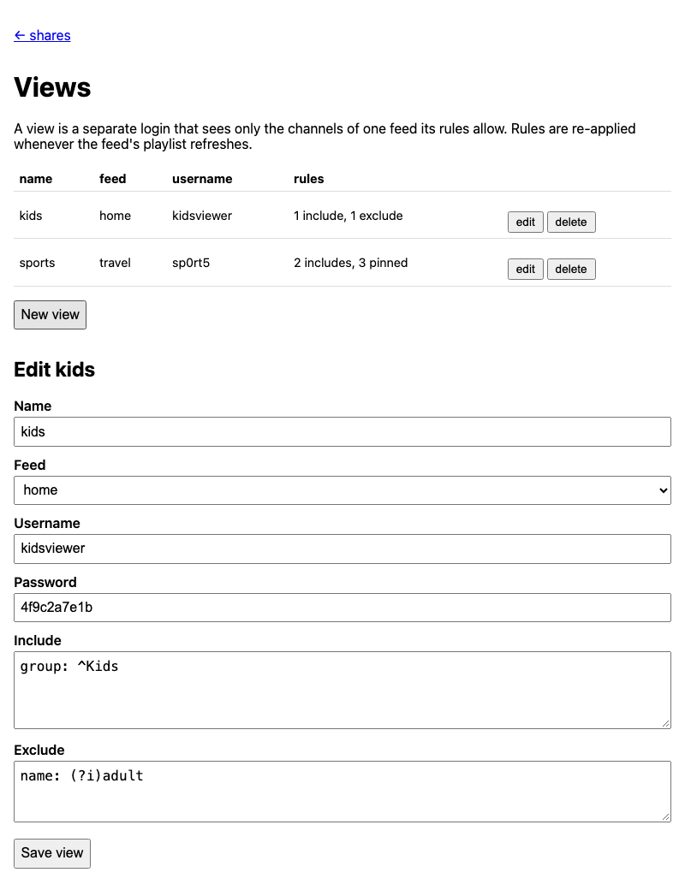

# iptv-proxy

Serves multiple upstream M3U8/Xtream IPTV feeds from one address, each behind its own username and password. Every playlist, segment and API response is rewritten so the real upstream URL and its credentials never reach the client.

## Features

- **Many feeds, one port.** The credentials on a request decide which feed serves it.
- **M3U and Xtream Codes.** The same feed works as a playlist URL or as an Xtream login, including `player_api.php`, `panel_api.php` and the EPG.
- **Smoother live playback.** Live streams reconnect when the upstream drops, and an optional delay buffer hides short stalls from the player.
- **Less upstream traffic.** Playlists and EPG data are cached, and the last good copy is served if a refresh fails.
- **Temporary share links.** Send one channel to someone for a limited time without giving out feed credentials.
- **Prometheus metrics** at `/metrics`, and a health check at `/health`.

## Install

### Docker

```sh
docker run -d --name iptv-proxy \
  --user "$(id -u):$(id -g)" \
  -p 58033:58033 \
  -v "$PWD/config.yaml:/config/config.yaml:ro" \
  ghcr.io/oskarrn93/iptv-proxy:latest
```

Images are published for `linux/amd64` and `linux/arm64`, tagged `X.Y.Z`, `X.Y`, `X` and `latest`. The registry is private, so run `docker login ghcr.io` first. `--user` should match the owner of `config.yaml`.

### Binary

Each [release](https://github.com/oskarrn93/iptv-proxy/releases) has archives for Linux and macOS on amd64 and arm64, plus `checksums.txt`.

```sh
gh release download --repo oskarrn93/iptv-proxy --pattern '*_linux_amd64.tar.gz'
tar -xzf iptv-proxy_*_linux_amd64.tar.gz
./iptv-proxy_*_linux_amd64/iptv-proxy -config config.yaml
```

## Configure

Copy [`config.yaml.example`](config.yaml.example) to `config.yaml` and fill in your feeds. The example documents every option.

```yaml
listen_addr: ":58033"

feeds:
  - name: feed-1
    upstream_url: "http://provider.example.com:8080/get.php?username=UPSTREAM_USER&password=UPSTREAM_PASS&type=m3u_plus&output=ts"
    username: proxyuser1
    password: proxypass1
```

Each feed's `username` must be unique across the file. Set the environment variable `METRICS_ENABLED=false` to turn off metrics.

## Connect a player

| App expects | Use |
| --- | --- |
| M3U URL | `http://<host>:58033/playlist.m3u8?username=<username>&password=<password>` |
| Xtream login | Server `http://<host>:58033`, with `<username>` and `<password>` |
| EPG (XMLTV) URL | `http://<host>:58033/epg?username=<username>&password=<password>` |

HTTP Basic Auth also works in place of the query parameters.

## Admin page


`/admin` creates and revokes share links. It's disabled unless `admin_allowed_cidrs` is set, and only clients in those ranges can reach it. Protect it in one of three ways:

- **Authenticating reverse proxy:** set `trusted_proxies`, and the app only answers requests that arrive through one of those proxies.
- **No reverse proxy:** set `admin_auth` to require an HTTP Basic login on every admin request.
- **OpenID Connect:** set `admin_oidc` to log in through your identity provider (authorization code flow with PKCE). It replaces `admin_auth`; set one or the other.

```yaml
admin_allowed_cidrs:
  - "192.168.1.0/24"
admin_auth:
  username: admin
  password: change-me
```

```yaml
admin_oidc:
  issuer: https://idp.example.com
  client_id: iptv-proxy
  redirect_url: https://iptv.example.com/admin/oidc/callback # register this with the provider
  allowed_emails:
    - you@example.com
```

Only the listed emails get in, and only if the provider reports them as verified. Sessions last 8 hours and end when the proxy restarts. `client_secret` is optional, for providers that insist on one.

Over plain HTTP, the password and share links are unencrypted, so only use `admin_auth` without TLS on a network you trust.

## Views

A view is a separate login that sees only the channels of one feed that its rules allow, for example one household member's picks. Set `views_file` and manage views at `/admin/views`:

```yaml
views_file: /data/views.json
```



- **Rules:** regexes on channel name, group or `tvg-id` to include or exclude, plus channels you pin (always shown) or block (never shown). Blocked beats pinned beats exclude beats include.
- **Re-matching:** rules are stored, not their results. When the upstream playlist changes, the view follows. The editor's preview flags pins and blocks that no longer match any channel.
- **Where it applies:** the M3U playlist, `player_api.php` live streams and categories, and stream playback (a view can't play a channel it doesn't list). VOD, series and the EPG are not filtered.
- **Storage:** views live in `views_file` (JSON, owner-only, passwords included). The proxy is the only writer, so run a single instance.

## Development

Requires Go 1.27.

```sh
go run ./cmd/iptv-proxy -config config.yaml
go test ./...
```

The admin UI has its own browser tests; see [`admin_ui_test`](internal/iptvproxy/admin_ui_test/README.md).

Releases are cut by running the **Release** workflow, which picks the next version from [conventional commits](https://www.conventionalcommits.org/) and publishes the image and binaries.
